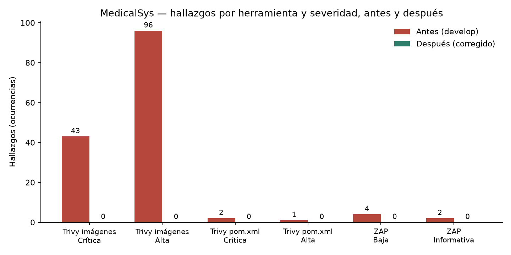

# Sección 13 — Reporte del escaneo de vulnerabilidades

**Tarea:** INF-08 (SINS-58) · **Responsable:** Juan Jose Claros Suntura · **Fecha de los escaneos:** 12/10/2026

Todas las cifras de esta sección salen de los reportes guardados en `docs/seguridad/escaneos/` y se reproducen con `python docs/seguridad/escaneos/resumen.py docs/seguridad/escaneos/<antes|despues>`.

## 13.1 Herramientas y configuración

| Herramienta | Versión | Qué analiza | Configuración |
|---|---|---|---|
| Trivy filesystem | 0.69.3 | Dependencias declaradas en los 14 `pom.xml` | `fs --scanners vuln --severity HIGH,CRITICAL --format json` |
| Trivy image | 0.69.3 | Las 14 imágenes `medicalsys/*` (paquetes del sistema y JAR) | `image --scanners vuln --severity HIGH,CRITICAL --format json --input <imagen>.tar` |
| OWASP ZAP Baseline | 2.17.0 | El gateway en ejecución, de forma pasiva | `zap-baseline.py -t http://host.docker.internal:<puerto>/actuator/health -m 1`; plan resultante en `zap.yaml` |

Las tres se ejecutan desde sus imágenes oficiales (`aquasec/trivy:0.69.3`, `ghcr.io/zaproxy/zaproxy:stable`) con un solo script, `docs/seguridad/escaneos/escanear.sh`, que se usó sin cambios de opciones en ambos escaneos. El procedimiento completo es PR-04.

No se ejecutó OWASP Dependency-Check: la tarea admite Trivy filesystem como alternativa y cubre los mismos manifiestos. No se ejecutó el API scan de ZAP porque la plataforma no publica una especificación OpenAPI.

| | Antes | Después |
|---|---|---|
| Versión | `origin/develop`, commit `baef748` | `feature/OWASP` con `develop` fusionado y HARD-01 a HARD-04 |
| Imágenes | Reconstruidas desde ese commit, etiqueta `:develop-baseline` | Reconstruidas desde el árbol corregido, etiqueta `:local` |
| Reportes | `docs/seguridad/escaneos/antes/` | `docs/seguridad/escaneos/despues/` |

## 13.2 Resultados del escaneo inicial

| Herramienta | Crítica | Alta | Baja | Informativa |
|---|---:|---:|---:|---:|
| Trivy filesystem | 2 | 1 | — | — |
| Trivy imágenes (14) | 43 | 96 | — | — |
| ZAP Baseline | 0 | 0 | 4 | 2 |

Las 139 ocurrencias de las imágenes se reducen a cinco componentes:

| Componente | Versión vulnerable | Severidad | Ocurrencias | CVE |
|---|---|---|---:|---|
| Tomcat (`tomcat-embed-core`) | 11.0.24 | Crítica | 39 | CVE-2026-65182, CVE-2026-65905, CVE-2026-68525 |
| Jackson (`jackson-databind`, `jackson-core`) | 3.1.5 y 2.21.5 | Alta | 75 | CVE-2026-68497, CVE-2026-89407, CVE-2026-89425, CVE-2026-91776, CVE-2026-91777 |
| `libssl3` (Ubuntu 22.04) | 3.0.2-0ubuntu1.29 | Alta | 14 | CVE-2026-84782 |
| Bouncy Castle (`bcprov-jdk18on`) | 1.78.1, 1.81.1 y 1.84 | 4 críticas, 3 altas | 7 | CVE-2025-14813, CVE-2026-8763, CVE-2026-13506 |
| `lz4-java` | 1.10.1 | Alta | 4 | CVE-2026-106451 |

Los tres hallazgos de Trivy filesystem son los de Bouncy Castle 1.78.1, declarado en `ms-identidad`.

ZAP exploró 8 URLs del gateway y no reportó ningún FAIL. Las alertas fueron `Cross-Origin-Resource-Policy Header Missing or Invalid` (baja, 4 URLs) y `Non-Storable Content` (informativa, 2 URLs).

## 13.3 Correcciones realizadas

| Hallazgo | Corrección | Dónde |
|---|---|---|
| Tomcat 11.0.24 | `tomcat.version` 11.0.25 | `pom.xml` de los 14 servicios |
| Jackson 3.1.5 / 2.21.5 | `jackson-bom.version` 3.1.7 y `jackson-2-bom.version` 2.21.7 | `pom.xml` de los 14 servicios |
| Bouncy Castle | `bcprov-jdk18on` 1.85 | `pom.xml` de `ms-identidad`, `ms-gateway` y `ms-documental` |
| `lz4-java` 1.10.1 | 1.11.4 | `pom.xml` de `ms-agenda`, `ms-marketing`, `ms-notificaciones` y `ms-pacientes` |
| `libssl3` | `apt-get upgrade` en la etapa final | `Dockerfile` de los 14 servicios |
| Cabecera CORP ausente | `Cross-Origin-Resource-Policy: same-origin` | `JwtPropagationFilter` del gateway |

Junto con las dependencias se aplicó el endurecimiento de HARD-04 en el gateway: `Strict-Transport-Security`, `X-Content-Type-Options`, `Content-Security-Policy: frame-ancestors 'none'`, `Referrer-Policy` y `X-Frame-Options`, y la cabecera `Server` vacía, también en las respuestas 401 y 503.

Las correcciones que un escáner no detecta (red interna, revocación de sesión, CORS, firma del webhook) se documentan con pruebas antes y después en la sección 11.

## 13.4 Resultados del escaneo posterior

| Herramienta | Crítica | Alta | Baja | Informativa |
|---|---:|---:|---:|---:|
| Trivy filesystem | 0 | 0 | — | — |
| Trivy imágenes (14) | 0 | 0 | — | — |
| ZAP Baseline | 0 | 0 | 0 | 0 |

## 13.5 Tabla comparativa

| Hallazgo | Severidad | Antes | Después | PR de la corrección |
|---|---|---:|---:|---|
| Trivy filesystem: Bouncy Castle 1.78.1 | Crítica | 2 | 0 | #14 |
| Trivy filesystem: Bouncy Castle 1.78.1 | Alta | 1 | 0 | #14 |
| Trivy imágenes: Tomcat 11.0.24 | Crítica | 39 | 0 | #14 |
| Trivy imágenes: Bouncy Castle | Crítica | 4 | 0 | #14 |
| Trivy imágenes: Bouncy Castle | Alta | 3 | 0 | #14 |
| Trivy imágenes: Jackson | Alta | 75 | 0 | #14 |
| Trivy imágenes: `libssl3` | Alta | 14 | 0 | #14 |
| Trivy imágenes: `lz4-java` | Alta | 4 | 0 | #14 |
| ZAP: cabecera CORP ausente | Baja | 4 | 0 | Pendiente: cambio posterior al #14 en `feature/OWASP` |
| ZAP: contenido no almacenable | Informativa | 2 | 0 | Sin corrección dirigida |
| **Total crítico y alto** | | **142** | **0** | |

PR #14: https://github.com/The-Furious-Five/medicalsys-platform_v1/pull/14. La cabecera CORP, las cabeceras en las respuestas 401/503 y la fusión de `develop` se hicieron después de ese PR y necesitan uno nuevo; al abrirlo hay que anotar aquí su número.

Todos los hallazgos críticos y altos quedaron corregidos. No hay riesgos aceptados.

## 13.6 Gráfico por severidad

El gráfico se genera desde los mismos reportes con `python docs/seguridad/escaneos/grafico.py`.

## 13.7 Limitaciones

- Trivy se ejecutó solo para severidades HIGH y CRITICAL. Puede haber hallazgos medios y bajos sin listar.
- Los conteos de imágenes son ocurrencias por imagen y paquete: una misma biblioteca vulnerable cuenta una vez por cada imagen que la contiene.
- ZAP Baseline es pasivo y sin autenticar, y solo alcanzó 8 URLs. No evalúa la API autenticada.
- La alerta informativa de ZAP desapareció sin un cambio dirigido a ella; no se cuenta como corrección.
- La base de vulnerabilidades de Trivy del reescaneo es más reciente que la de la línea base.
- Los escaneos se hicieron en un entorno local, no sobre el despliegue público.
